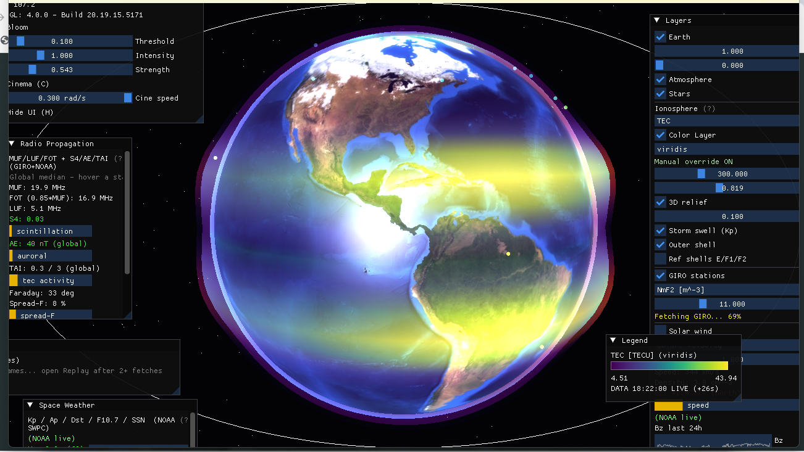

# Ionosphere Live 3D

Real-time 3D ionosphere and space-weather visualizer (C++17 / OpenGL 4.0).
A textured Earth with day/night terminator, city lights and animated clouds,
wrapped in live data shells: TEC, GIRO ionosondes, HF propagation, solar wind,
auroral oval and more — all switchable, with a time-travel replay mode.



## Features

**Globe & realism**
- Day/night Earth with soft twilight band, ocean sun glitter (Blinn-Phong),
  NASA Black Marble city lights on the night side, procedural animated clouds.
- Milky-Way starfield (1600 tinted stars), fresnel atmosphere, bloom
  post-processing (threshold/intensity/strength), real-sun terminator line.
- 3D relief: the data shell deforms radially with the local value and
  "breathes" with Kp (storm swell), plus a nested outer shell (volumetric look).
- Reference altitude rings E/F1/F2 (110/200/300 km). Cinema mode (auto-rotate,
  `C`) and full UI hide (`H`).

**Ionosphere layers** (spherical color shell, 8 variables)
- **TEC** (TECU, NOAA GloTEC, 10-min cadence) with session replay + history preload.
- **foF2 / MUF / hmF2 / NmF2** interpolated (IDW) from ~129 GIRO stations,
  with median background (no ocean cliffs).
- **LUF / FOT / Spread-F** derived per ITU practice.
- Per-variable colormaps (viridis/inferno/plasma/turbo) + manual override,
  altitude/opacity sliders, live legend with units, range and data timestamp.

**Stations & radio**
- GIRO points colored by metric, hover tooltips with foF2 sparkline (~2 h),
  click-to-pin; per-station MUF/LUF/FOT/S4/Faraday/Spread-F panel.
- Direct Ebro Observatory SAO profile for EB040 (FTP, full 16-parameter
  decode: foF1/foE/foEs/fmin/fxI, virtual heights, hmF2/B0/B1) with GIRO cross-check.
- Faraday rotation 3D vectors driven by local TEC; NOAA Ovation auroral oval.

**Space weather HUD**
- Kp/Dst/F10.7/Ap/SSN (all live NOAA SWPC, per-field mock fallback),
  solar-wind speed/density/Bz arrows + 24 h plots, Carrington rotation + sun disk.

**Time & UX**
- Timeline: LIVE vs REPLAY (TEC frames + GIRO history scrub, loop, 0.5–8 fps).
- Every variable has an English tooltip (`(?)` markers); UTC clock + subsolar
  readout; GUI values persist to `settings.cfg` (window layout in `imgui.ini`).

## Data sources

| Data | Source | Refresh |
|---|---|---|
| TEC | NOAA SWPC GloTEC (GeoJSON 72×72) | 5 min + 3 h preload |
| foF2/MUF/hmF2/… | GIRO DIDBase `scaled.php` (129 stations) | 5 min |
| EB040 profile | Ebre Observatory FTP (`EB040_*.SAO`) | 5 min, background |
| Kp/Dst/F10.7/Ap/SSN | NOAA SWPC JSON | 5 min |
| Solar wind | NOAA RTSW 1-min | 5 min |
| Aurora | NOAA Ovation | 5 min |
| Night lights | NASA Black Marble 2016 | static texture |

Any unreachable source degrades gracefully (per-field mock/offline badges,
stale-data warnings). GIRO data: CC BY-NC-SA 4.0 (non-commercial).

## Controls

- Drag: orbit · wheel / `+`–`-`: zoom · `Esc`: quit
- `C`: cinema mode · `H`: hide UI
- Panels: Layers · Space Weather · Radio Propagation · Legend · Timeline

## Build (MSYS2 UCRT64)

```powershell
cmake -B build -G Ninja
cmake --build build -j
.\build\ionosphere-live-3d.exe
```

Requires: `glfw`, `curl` (MSYS2), vendored glad/imgui/glm/stb in `libs/`.
Textures and shaders are copied next to the binary automatically.

## Layout

```
src/App.cpp          # composition, timeline, replay, all panels
src/Data/            # one adapter per source (fetch + parse + fallback)
src/Ionosphere/      # GridLayer, IonosondeLayer, SolarWindLayer,
                     #   FaradayLayer, RefShells
src/Globe/           # Earth (+night), Stars, Atmosphere, Terminator
src/Render/  src/UI/  src/Utils/   # camera/shaders/FBO, stubs, sun math
shaders/  textures/  data/
```
