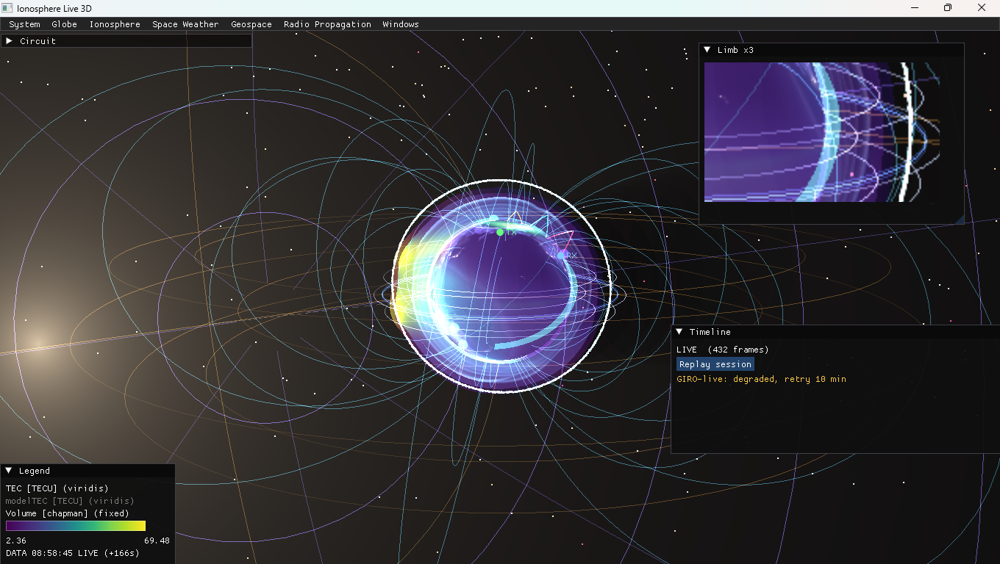
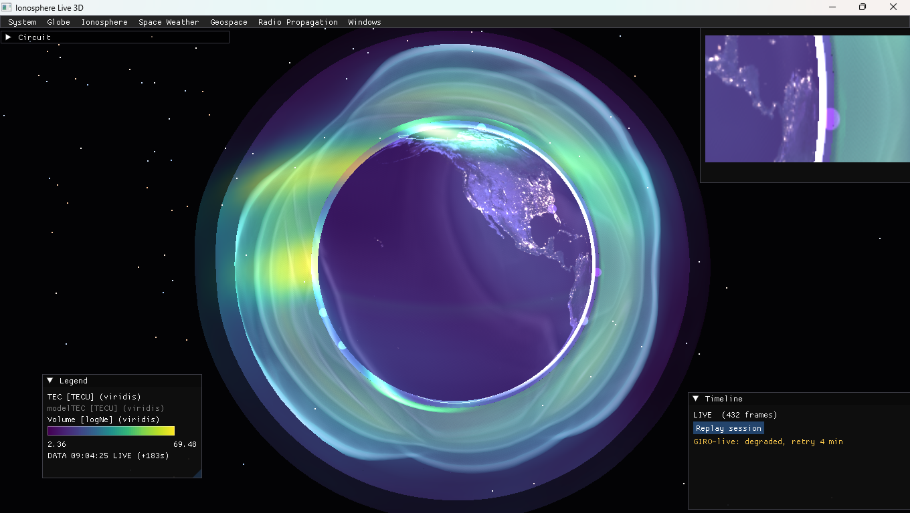
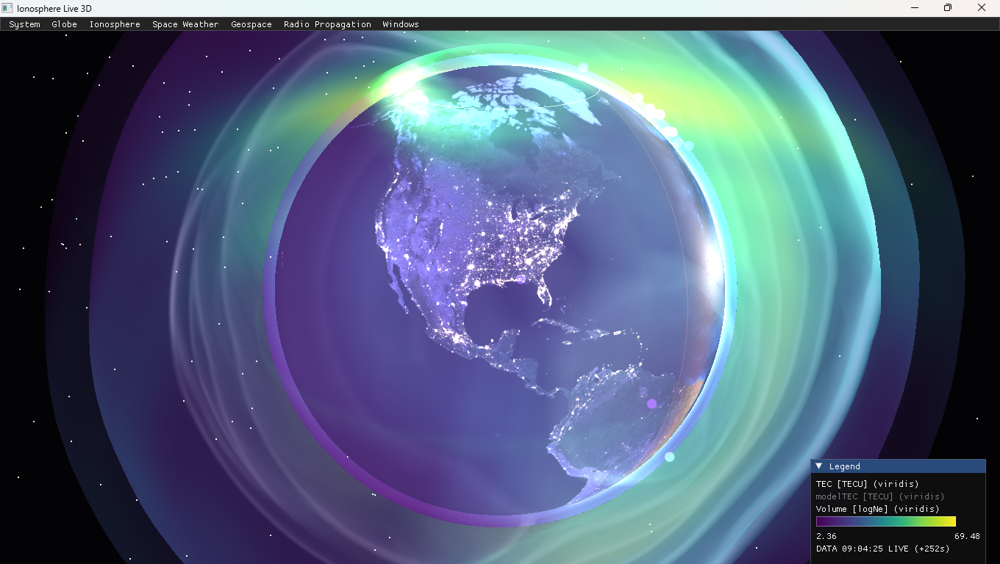

# Ionosphere Live 3D

Real-time 3D ionosphere and space-weather visualizer (C++17 / OpenGL 4.0).
A textured Earth with day/night terminator, city lights and animated clouds,
wrapped in live data shells: TEC, GIRO ionosondes, HF propagation, solar wind,
auroral oval and more — all switchable, with a time-travel replay mode.

On top of the ionosphere it also carries **bonus extras that are not
ionospheric data**: the live satellite catalogue, the Voyager probes, the
Parker spiral, the Shue-1998 magnetopause, the Van Allen belts, the 1963 West
Ford ring and solar imagery. They share the same rules as everything else —
off by default, persisted, labelled with their real source, and empty rather
than invented when the source fails. See
[docs/bonus-extras.md](docs/bonus-extras.md) for the per-feature detail.


|  |  |
|---|---|
| Full UI with honest-state badge | SDO Sun panel + limb zoom |
|  |  |
| Timeline replay with E/F1/F2 reference shells | TLE orbit rings + geospace overlays, with the Limb x3 inset |
|  |  |
| Volumetric Ne shell + aurora over the night side | Night close-up: Black Marble city lights, volume shell and aurora |

## What's inside

| Area | Contents |
|---|---|
| **Ionosphere (core)** | TEC, foF2/MUF/hmF2/NmF2, LUF/FOT/Spread-F, IRTAM foF2/hmF2/B0/B1, volumetric Ne, path slice, F2-peak shell, model TEC, GIRO stations, Faraday rotation |
| **Radio** | HF trace layer, WSPR arcs, D-RAP absorption map, Ebro SAO profile, legend + timeline |
| **Space weather** | Kp/Dst/F10.7/Ap/SSN, GOES X-ray, solar-wind arrows, aurora oval, AE electrojets, Dst ring, grey line, CME shock front |
| **Bonus extras (not ionosphere)** | Magnetopause + IGRF field lines, solar-wind river, Van Allen belts, West Ford 1963 ring, satellites (TLE), Parker spiral panel, Voyager 1/2 panel, LASCO C2 + D-RAP window, storm sprites + whistlers |

## Features

**Globe & realism**
- Day/night Earth with soft twilight band, ocean sun glitter (Blinn-Phong),
  NASA Black Marble city lights on the night side (HiRes 13K where the GPU
  allows, anisotropic filtering), procedural animated clouds.
- Milky-Way starfield (1600 tinted stars), fresnel atmosphere, bloom
  post-processing (threshold/intensity/strength), ACES tone mapping with
  bypass toggle + manual exposure, real-sun terminator line (toggleable).
- 3D relief: the data shell deforms radially with the local value and
  "breathes" with Kp (storm swell), plus a nested outer shell with its own
  opacity/colormap controls.
- Reference altitude rings E/F1/F2 (E fixed, F1/F2 follow measured hmF2).
  Cinema mode (auto-rotate, `C`), guided tour in English or Spanish (`T`) and
  full UI hide (`H`).

**Ionosphere layers** (spherical color shell, 12 variables)
- **TEC** (TECU, NOAA GloTEC, 10-min cadence) with session replay + history preload.
- **foF2 / MUF / hmF2 / NmF2** interpolated (IDW) from ~129 GIRO stations,
  with median background (no ocean cliffs).
- **LUF / FOT / Spread-F** derived per ITU practice.
- **IRTAM foF2 / hmF2 / B0 / B1** (retrospective, UML LGDC gambit-coeffs,
  ~3-day lag by design): data-assimilated 46×45 grids evaluated from
  Jones-Gallet coefficients (no resampling). Honest states — no data shows
  the reason (`backfill…` / `429… passive retry`), never silence; in replay
  the layer freezes with a declared out-of-window note. Badge shows walking
  DATA-age from the message TOV.
- Per-variable colormaps (viridis/inferno/plasma/turbo) + manual override,
  altitude/opacity sliders, live legend with units, range and data timestamp.
- **Volumetric density**: real raymarched Ne(lat, lon, h) rebuilt from station
  profiles (Chapman + Epstein) every ~5 s, with day/night D-layer and GOES
  flare boost; nested outer shell + storm-swell relief.
- **Path slice**: vertical Ne(h) curtain between pinned (A) and hovered (B)
  station with peak log-density readout.
- **F2 peak shell**: floats at the real measured hmF2 per column, colored by
  peak log-density (derived from the volume, always consistent with it).
- **Model TEC**: TEC integrated from the volume (compare vs measured GloTEC).
- **Display helpers**: iso-contour bands, 3D labels with leader lines, the
  limb-zoom inset (`Windows > Limb x3`) and an exploded view (×1–×5) that
  separates the shells without touching the data.
- **HF trace layer** (`Windows > Circuit`): the HF ray path for the selected
  frequency drawn as a camera-facing ribbon (green = hop open, amber =
  marginal, red = closed) with a pulse travelling along the arc.

**Stations & radio**
- GIRO points colored by metric, hover tooltips with foF2 sparkline (~2 h),
  click-to-pin; per-station MUF/LUF/FOT/S4/Faraday/Spread-F panel.
- Direct Ebro Observatory SAO profile for EB040 (FTP, full 16-parameter
  decode: foF1/foE/foEs/fmin/fxI, virtual heights, hmF2/B0/B1) with GIRO cross-check.
- Faraday rotation 3D vectors driven by local TEC; NOAA Ovation auroral oval.

**Space weather HUD**
- Kp/Dst/F10.7/Ap/SSN (all live NOAA SWPC, per-field mock fallback), GOES
  X-ray flux/class for flares, solar-wind arrows colored by speed, Bz and
  density (web ramp) + 24 h plots, Carrington rotation + sun disk.
- **Aurora oval**: NOAA Ovation forecast shell at ~110 km over both poles,
  opacity slider, expands and brightens with storms.
- **AE electrojets**: two loops at ±67° coloured by the real Kyoto AE when the
  quicklook file is available, otherwise by the declared Kp proxy (the label
  says which one). See the port log below for the Kyoto lag.
- **Dst ring**: equatorial ring whose radius closes with the storm
  (web formula `5.5 + Dst/100`, clamped to 3.5–6 R_E), compressed on screen to
  1.25–1.80 R_E so it stays visible at the default camera distance.
- **Grey line**: ±7.5° ribbon around the live terminator (solar zenith
  82.5–97.5°), the twilight band that matters for HF paths.
- **CME shock front**: spherical cap at the ENLIL half-angle around the
  Sun–Earth axis, scaled by the transit progress.

## Bonus extras (not ionosphere)

Everything in this section is deliberately *outside* the ionospheric data
contract: it is space physics, heliophysics or historical hardware. Same
house rules though — each one starts **off**, persists in `settings.cfg`, and
draws nothing (rather than a synthetic placeholder) when its source is
unavailable.

| Extra | What you see | Data | Scale / status |
|---|---|---|---|
| **Magnetopause + field lines** | Shue-1998 wireframe plus IGRF-14 degree-1 dipole lines at L = 1.5 / 2.5 / 4.0 / 6.0 | live RTSW wind (n, v, Bz) | true R_E, standoff 6–12 R_E, θ ≤ 105° |
| **Solar-wind river** | 400 particles born dayside, pushed around the cavity, recycled at x = −28 R_E | live RTSW wind | true R_E, v×60 declared, obstacle = 0.98·r_Shue |
| **Van Allen belts** | Two tori: inner protons L = 1.5 (silver), outer electrons L = 4.2 + 0.08·Kp (amber), drift knots west/east | Kp (NOAA) | 1–4.9 R_E, geographic equator |
| **West Ford 1963 ring** | 4096 deterministic samples in one orbital plane (87.4° incl, 3600–3680 km) | none (static) | declared reconstruction, fixed node |
| **Satellites (TLE)** | Live catalogue points coloured by regime + instantaneous orbit rings | CelesTrak → SatNOGS → disk cache | **visual-grade**, TLE mean elements + J2, no SGP4 |
| **Parker spiral** | 2D top-down panel: Parker 1958 spiral with the live wind, sector polarity from Bx GSE | live RTSW speed + 25.38 d sidereal | panel only (1 AU does not fit the R_E view) |
| **Voyager 1/2** | Range, one-way light time and a declared Friis link budget (8.42 GHz X-band, 23 W, 3.7 m / 70 m dishes) | JPL Horizons (−31 / −32) | 6 h cache; *no range, no claim* |
| **LASCO C2 + D-RAP** | Coronagraph and absorption map in their own `Windows > Solar imagery` window | SOHO realtime JPEG, NOAA SWPC | 15 min, disk cached, live/cached label + age |
| **Storm sprites + whistlers** | Marker on each active NWS Severe Thunderstorm Warning centroid + the real IGRF duct through it | NWS warnings | warned storms, **no flash counts claimed** |

**Why the extras are honest, not decorative**
- The magnetopause, the river and the outer belt are drawn at **true R_E
  scale**. They do not fit a camera parked on the globe, so each toggle pulls
  the camera back once (20 / 38 / 8 R_E) and every one of them has a `Fit`
  button. Zoom is clamped at 45 R_E.
- The river's `v·60` is a **declared visual exaggeration** (at 400 km/s the real
  flow would cross 43 R_E in 11 minutes); the physics is in the Shue surface
  that decides the deflection, and the colour uses the real speed, Bz and
  density. The obstacle scales only `(y, z)`, which is the web behaviour, not a
  port bug. Determinism comes from a seeded mulberry32 (the web used
  `Math.random`).
- The CME front compresses the ~215 R_E transit into 1.8 → 19.5 R_E (declared
  linear compression): **position is not physical, the ETA and speed are**.
- The West Ford ring's node is a fixed declared value — no propagation, no
  simulated rotation, no live data.
- Satellites use TLE mean elements + J2 secular drift (no SGP4/SDP4), so they
  are **not for tracking**; the source label says which catalogue was drawn.
- Voyager publishes only what Horizons returned for the row it served.

## Port log — what came from the `ionosphere-web` demo

The geospace overlays and the data layers below were ported from
[`ionosphere-web`](https://github.com/valledemena/ionosphere-web)
(`IonosphereScene.tsx`) with matching defaults, tooltips and persistence.
Every module keeps the web behaviour and adds the same honesty rules: no
synthetic fallback, `off` until the source is actually used.

- **Batch 1 — geospace overlays**: live **Dst ring** (true 3.5–6 R_E, drawn at
  1.25–1.80 R_E), **electrojet loops** at ±67° coloured by AE, and a
  **±7.5° grey-line ribbon**. No network calls of their own.
- **Batch 2 — space-weather geometry at true scale**: **Shue-1998
  magnetopause** (r0 = [10.22 + 1.29·tanh(0.184·(Bz + 8.14))] / Dp^(1/6.6),
  Dp = 1.6726e-6·n·v²) with **IGRF-14 degree-1 dipole field lines** (epoch
  2025.0, 9.2° tilt), **Van Allen belts** and the static **West Ford 1963**
  ring. Wireframe stops at θ = 105°; the night-side stretch is a declared v1
  parameterisation, not Tsyganenko.
- **Batch 3 — live data layers** (each fetches while its layer is visible, the
  Geospace panel is open, or Provider status is expanded): **WSPR arcs** from
  wsprnet.org (one great-circle arc per spot, band colour, 10 min TTL, 40-arc
  cap); **CME shock front** from the newest WSA-ENLIL run with an Earth
  arrival time; **storm sprites + whistlers** from NWS Severe Thunderstorm
  Warning polygons (sprite on the centroid + the real IGRF dipole duct).
  No data means nothing is drawn — no synthetic fallbacks, and no flash
  counts are claimed (GLM granules are NetCDF and out of scope).
- **Batch 4 — satellites, solar imagery and flares**: **satellite layer**
  (CelesTrak active catalogue → SatNOGS → disk cache, label says which),
  declared **visual-grade** propagation, regime colours (LEO cyan, MEO
  yellow, GEO magenta, HEO orange) and instantaneous orbit rings for a
  deterministic subset (max 150); **LASCO C2** and **NOAA SWPC D-RAP** in the
  `Windows > Solar imagery` window (own GL textures, live/cached label, age,
  pixel size, disk cache); **DONKI FLR** flares (72 h, class C/M/X, peak time,
  active region) in the Geospace panel.
- **Batch 5 — real AE, Voyager, radiation-belt events, Parker spiral**:
  **AE** from the Kyoto WDC quicklook files (real index, used by the
  electrojet overlay; Kyoto publishes with a lag of days to ~3 weeks by
  design, so the adapter walks back up to 35 days, keeps 24 h of minute values
  and declares the day served; the Kp-derived proxy is only used while there
  is no real file); **Voyager 1/2** range from JPL Horizons (172.8 AU and
  144.5 AU at the last check) with light time and the declared Friis budget in
  a `Windows > Voyager` window; **DONKI RBE** events (58-day window, newest
  first) in the Geospace panel; **Parker spiral** in a 2D `Windows > Parker
  spiral` window driven by the live wind, sector polarity from the measured Bx
  GSE (declared convention: +X = toward) and the last real sector crossing
  within 6 h — no crossing, no notice. At 1 AU and 400 km/s the spiral lags
  61.4°, so the panel is schematic by construction.
- **Batch 5E — solar-wind river (W-4 #4)**: the 400-particle flow ported as
  its **own layer with its own toggle**, independent from the magnetopause
  layer and from the arrows. Birth at 18 R_E on the dayside, antisolar drift
  at `v·60`, Shue-1998 obstacle at 98 % of the cavity radius, recycle at
  x = −28 R_E, two additive passes (core 0.17 R_E / α 0.9, glow 0.38 R_E /
  α 0.16) with distance attenuation, and the same colour ramp as the arrows.
  Deterministic (`mulberry32`, fixed seed) and unit-tested (46 checks).

## Data sources

| Data | Source | Refresh |
|---|---|---|
| TEC | NOAA SWPC GloTEC (GeoJSON 72×72) | 5 min + 3 h preload |
| foF2/MUF/hmF2/… | GIRO DIDBase `scaled.php` (129 stations) | 5 min |
| foF2/MUF/hmF2/… (failover) | prop.kc2g.com redistribution (GIRO data with permission, WWROF-supported, plus eSWua/INGV and NOAA feeds) | on GIRO failure only, 1 req/10 min |
| EB040 profile | Ebre Observatory FTP (`EB040_*.SAO`) | 5 min, background |
| IRTAM foF2/hmF2/B0/B1 | UML LGDC `gambit-coeffs` (Jones-Gallet coeffs, 46×45 evaluated) | 15-min slots, ~3 d lag; cold backfill 384/param, steady ≤4/cycle, 1 req/15 s shared LGDC gate |
| Kp/Dst/F10.7/Ap/SSN | NOAA SWPC JSON | 5 min |
| Solar wind | NOAA RTSW 1-min | 5 min |
| Aurora | NOAA Ovation | 5 min |
| X-ray flux (D-layer/flares) | NOAA GOES primary | 5 min |
| WSPR spots | wsprnet.org (band · SNR · grid) | 5 min, 10 min spot TTL |
| CME / shock arrival | CCMC WSA-ENLIL (newest run) | 30 min |
| Storm cells (sprites/whistlers) | NWS Severe Thunderstorm Warnings | 5 min |
| Satellites (TLE) | CelesTrak active catalogue → SatNOGS → disk cache | 1 h fetch, 6 h catalogue TTL |
| LASCO C2 coronagraph | SOHO/NASA-ESA realtime JPEG (1024×1024) | 15 min, disk cache |
| D-RAP absorption map | NOAA SWPC `images/d-rap/global.png` (model output, 850×475) | 15 min, disk cache |
| Solar flares | CCMC DONKI FLR (72 h, GOES classes) | 30 min |
| AE (auroral electrojet) | Kyoto WDC quicklook `ae_realtime/data_dir/YYYY/MM/DD/aeYYMMDD` | 30 min, walk-back ≤35 d (source lags days to ~3 weeks), disk cache |
| Voyager 1/2 range | JPL Horizons `ssd.jpl.nasa.gov/api/horizons.api` (COMMAND -31/-32, QUANTITIES 20) | 6 h, disk cache |
| Radiation belt enhancements | CCMC DONKI RBE (58-day window) | 30 min, disk cache |
| Night lights | NASA Black Marble 2016 | static texture |

**Model / derived layers** — these reuse the fetches above and never issue a
request of their own:

| Layer | Derived from |
|---|---|
| Magnetopause, solar-wind river, solar-wind arrows | RTSW wind (speed, density, Bz) |
| Van Allen belts, storm swell | Kp from the NOAA index bundle |
| Dst ring, electrojets, grey line | Dst / AE / solar ephemeris |
| Parker spiral | RTSW speed + pinned 25.38 d sidereal rotation |
| West Ford 1963 ring | static reconstruction (no data) |
| Volume, F2-peak shell, model TEC | the station profiles already loaded |

Any unreachable source degrades gracefully (per-field mock/offline badges,
stale-data warnings). GIRO data: CC BY-NC-SA 4.0 (non-commercial).
Please cite: Reinisch, B. W., and I. A. Galkin, Global ionospheric radio
observatory (GIRO), Earth, Planets and Space, 63, 377-381,
doi:10.5047/eps.2011.03.001, 2011 — SPASE: http://spase.info/SMWG/Observatory/GIRO.
Access policy: polite cadence and mirrors lower the risk; they don't remove
it — we have measured 429/504 under load, which is why the kc2g failover exists.
LGDC traffic (catalog/getbest/gambit) shares one 15 s pacing gate with
timestamped `stderr` trace lines (`[LGDC …] launch / gate-consult / result`).

## Honest states

- Every adapter publishes its own status. A source stays `off` until it is
  actually used, then goes `ok` / `stale` (2× its nominal cadence) /
  `degraded` (declared wait) / `rate-limited` / `failed` with the real error.
- Failures never overwrite the last good data or its age; the UI says how old
  the data is instead of pretending it is fresh.
- Nothing is invented to fill a gap: no synthetic satellites, no made-up
  Voyager range, no fake CME, no mock river wind, no lightning counts. When a
  layer has nothing to draw, it draws nothing and the status line says why.

## Controls

- Drag: orbit · wheel / `+`–`-`: zoom · `Esc`: quit
- `C`: cinema mode · `H`: hide UI · `T`: guided tour (ES/EN) · `E`: export
  `iono-YYYYMMDD-HHMMSSZ.png`
- Panels: Layers · Space Weather · Radio Propagation · Legend · Timeline
- Windows: `Circuit`, `Legend`, `Altitude`, `Limb x3`, `Timeline`, `Sun`,
  `Geospace`, `Solar imagery`, `Parker spiral`, `Voyager`

## Build (MSYS2 UCRT64)

```powershell
cmake -B build -G Ninja
cmake --build build -j
.\build\ionosphere-live-3d.exe
```

Requires: `glfw`, `curl` (MSYS2), vendored glad/imgui/glm/stb in `libs/`.
Textures and shaders are copied next to the binary automatically.

Tests (no GPU needed): `ctest --test-dir build --output-on-failure`.

## Layout

```
src/App.cpp          # composition, timeline, replay, all panels, persistence
src/Data/            # one adapter per source (fetch + parse + fallback), plus
                     #   pure math: ShueMath, SolarWindRamp, ParkerMath,
                     #   OrbitProp (TLE + J2), ProviderStatus
src/Ionosphere/      # GridLayer, IonosondeLayer, SolarWindLayer, SolarWindRiver
                     #   (+ SolarWindRiverSim), MagnetosphereLayer, VanAllenBelts,
                     #   WestFordRing, GeospaceOverlays, SatellitesLayer, WsprArcs,
                     #   CmeLayer, WhistlerLayer, HfTraceLayer, FaradayLayer,
                     #   RefShells, VolumeRenderer, SliceLayer,
                     #   LayerProfile/DensityVolume (pure profile math)
src/Globe/           # Earth (+night HiRes), Stars, Atmosphere, Terminator
src/Render/          # camera, shaders, framebuffers (MSAA optional)
src/UI/              # SidePanel, StationPanel, GeospacePanel, SolarImagesPanel,
                     #   ParkerPanel, VoyagerPanel, SunPanel, TimelineBar
src/Utils/           # sun math, IGRF, colormaps, exporter, tour, god rays
docs/                # design notes + bonus-extras.md (this repo's extras)
shaders/  textures/  data/
```
