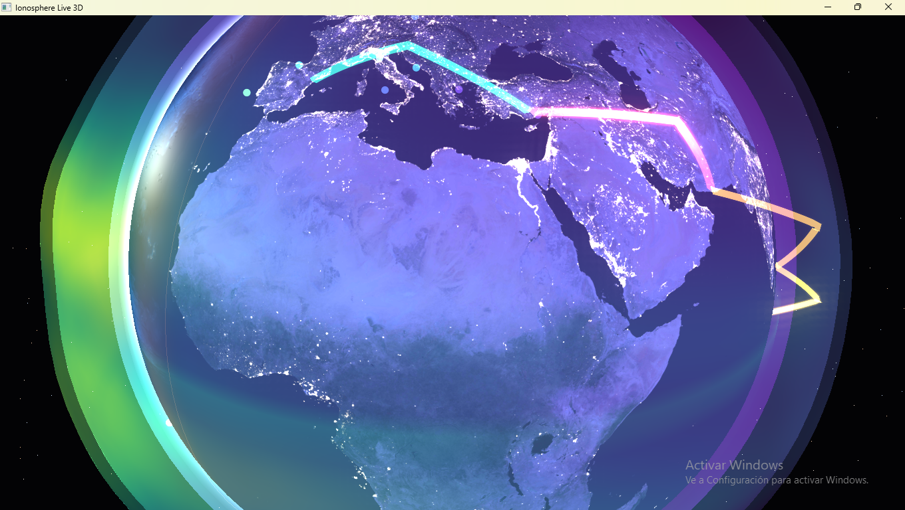
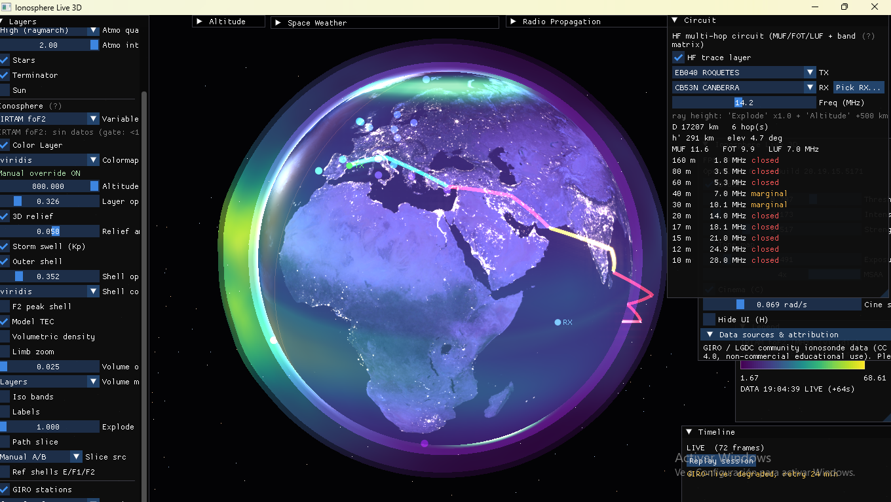
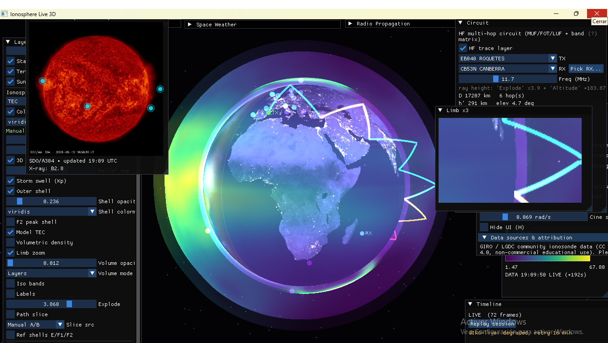
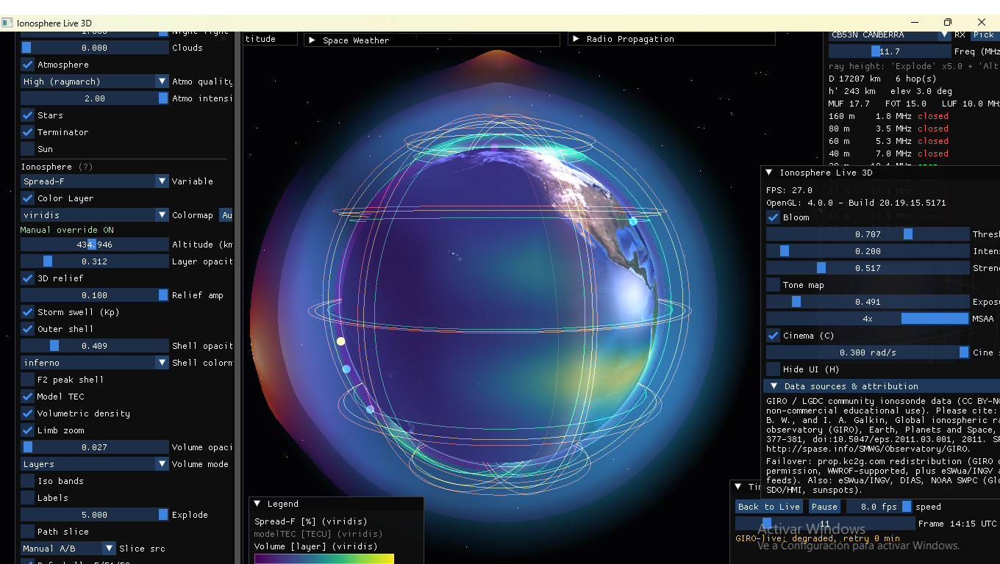
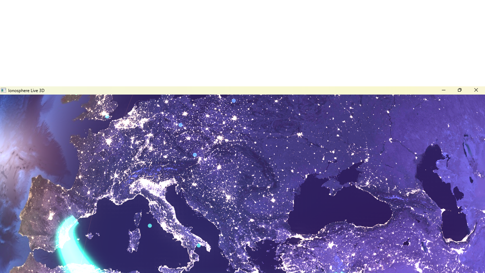

# Ionosphere Live 3D

Real-time 3D ionosphere and space-weather visualizer (C++17 / OpenGL 4.0).
A textured Earth with day/night terminator, city lights and animated clouds,
wrapped in live data shells: TEC, GIRO ionosondes, HF propagation, solar wind,
auroral oval and more — all switchable, with a time-travel replay mode.



|  |  |
|---|---|
| Full UI with honest-state badge | SDO Sun panel + limb zoom |
|  |  |
| Timeline replay with E/F1/F2 reference shells | Black Marble HiRes city lights, close-up |

## Features

**Globe & realism**
- Day/night Earth with soft twilight band, ocean sun glitter (Blinn-Phong),
  NASA Black Marble city lights on the night side (HiRes 13K where the GPU
  allows, anisotropic filtering), procedural animated clouds.
- Milky-Way starfield (1600 tinted stars), fresnel atmosphere, bloom
  post-processing (threshold/intensity/strength), ACES tone mapping with
  bypass toggle + manual exposure, real-sun terminator line (toggleable).
- 3D relief: the data shell deforms radially with the local value and
  "breathes" with Kp (storm swell), plus a nested outer shell with its own
  opacity/colormap controls.
- Reference altitude rings E/F1/F2 (E fixed, F1/F2 follow measured hmF2).
  Cinema mode (auto-rotate, `C`) and full UI hide (`H`).

**Ionosphere layers** (spherical color shell, 12 variables)
- **TEC** (TECU, NOAA GloTEC, 10-min cadence) with session replay + history preload.
- **foF2 / MUF / hmF2 / NmF2** interpolated (IDW) from ~129 GIRO stations,
  with median background (no ocean cliffs).
- **LUF / FOT / Spread-F** derived per ITU practice.
- **IRTAM foF2 / hmF2 / B0 / B1** (retrospective, UML LGDC gambit-coeffs,
  ~3-day lag by design): data-assimilated 46×45 grids evaluated from
  Jones-Gallet coefficients (no resampling). Honest states — no data shows
  the reason (`backfill…` / `429… passive retry`), never silence; in replay
  the layer freezes with a declared out-of-window note. Badge shows walking
  DATA-age from the message TOV.
- Per-variable colormaps (viridis/inferno/plasma/turbo) + manual override,
  altitude/opacity sliders, live legend with units, range and data timestamp.
- **Volumetric density**: real raymarched Ne(lat, lon, h) rebuilt from station
  profiles (Chapman + Epstein) every ~5 s, with day/night D-layer and GOES
  flare boost; nested outer shell + storm-swell relief.
- **Path slice**: vertical Ne(h) curtain between pinned (A) and hovered (B)
  station with peak log-density readout.
- **F2 peak shell**: floats at the real measured hmF2 per column, colored by
  peak log-density (derived from the volume, always consistent with it).
- **Model TEC**: TEC integrated from the volume (compare vs measured GloTEC).

**Stations & radio**
- GIRO points colored by metric, hover tooltips with foF2 sparkline (~2 h),
  click-to-pin; per-station MUF/LUF/FOT/S4/Faraday/Spread-F panel.
- Direct Ebro Observatory SAO profile for EB040 (FTP, full 16-parameter
  decode: foF1/foE/foEs/fmin/fxI, virtual heights, hmF2/B0/B1) with GIRO cross-check.
- Faraday rotation 3D vectors driven by local TEC; NOAA Ovation auroral oval.

**Space weather HUD**
- Kp/Dst/F10.7/Ap/SSN (all live NOAA SWPC, per-field mock fallback), GOES
  X-ray flux/class for flares, solar-wind speed/density/Bz arrows + 24 h
  plots, Carrington rotation + sun disk.

**Time & UX**
- Timeline: LIVE vs REPLAY (TEC frames + GIRO history scrub, loop, 0.5–8 fps).
- Every variable has an English tooltip (`(?)` markers); UTC clock + subsolar
  readout; GUI values persist to `settings.cfg` (window layout in `imgui.ini`).

## Data sources

| Data | Source | Refresh |
|---|---|---|
| TEC | NOAA SWPC GloTEC (GeoJSON 72×72) | 5 min + 3 h preload |
| foF2/MUF/hmF2/… | GIRO DIDBase `scaled.php` (129 stations) | 5 min |
| foF2/MUF/hmF2/… (failover) | prop.kc2g.com redistribution (GIRO data with permission, WWROF-supported, plus eSWua/INGV and NOAA feeds) | on GIRO failure only, 1 req/10 min |
| EB040 profile | Ebre Observatory FTP (`EB040_*.SAO`) | 5 min, background |
| IRTAM foF2/hmF2/B0/B1 | UML LGDC `gambit-coeffs` (Jones-Gallet coeffs, 46×45 evaluated) | 15-min slots, ~3 d lag; cold backfill 96/param, steady ≤4/cycle, 1 req/15 s shared LGDC gate |
| Kp/Dst/F10.7/Ap/SSN | NOAA SWPC JSON | 5 min |
| Solar wind | NOAA RTSW 1-min | 5 min |
| Aurora | NOAA Ovation | 5 min |
| X-ray flux (D-layer/flares) | NOAA GOES primary | 5 min |
| Night lights | NASA Black Marble 2016 | static texture |

Any unreachable source degrades gracefully (per-field mock/offline badges,
stale-data warnings). GIRO data: CC BY-NC-SA 4.0 (non-commercial).
Please cite: Reinisch, B. W., and I. A. Galkin, Global ionospheric radio
observatory (GIRO), Earth, Planets and Space, 63, 377-381,
doi:10.5047/eps.2011.03.001, 2011 — SPASE: http://spase.info/SMWG/Observatory/GIRO.
Access policy: polite cadence and mirrors lower the risk; they don't remove
it — we have measured 429/504 under load, which is why the kc2g failover exists.
LGDC traffic (catalog/getbest/gambit) shares one 15 s pacing gate with
timestamped `stderr` trace lines (`[LGDC …] launch / gate-consult / result`).

## Controls

- Drag: orbit · wheel / `+`–`-`: zoom · `Esc`: quit
- `C`: cinema mode · `H`: hide UI
- Panels: Layers · Space Weather · Radio Propagation · Legend · Timeline

## Build (MSYS2 UCRT64)

```powershell
cmake -B build -G Ninja
cmake --build build -j
.\build\ionosphere-live-3d.exe
```

Requires: `glfw`, `curl` (MSYS2), vendored glad/imgui/glm/stb in `libs/`.
Textures and shaders are copied next to the binary automatically.

## Layout

```
src/App.cpp          # composition, timeline, replay, all panels, persistence
src/Data/            # one adapter per source (fetch + parse + fallback)
src/Ionosphere/      # GridLayer, IonosondeLayer, SolarWindLayer,
                     #   FaradayLayer, RefShells, VolumeRenderer, SliceLayer,
                     #   LayerProfile/DensityVolume (pure profile math)
src/Globe/           # Earth (+night HiRes), Stars, Atmosphere, Terminator
src/Render/  src/UI/  src/Utils/   # camera/shaders/FBO, stubs, sun math, colormaps
shaders/  textures/  data/  docs/
```
